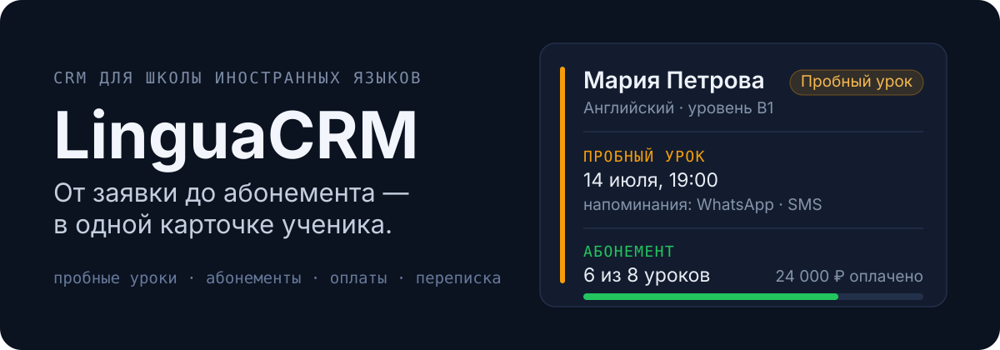
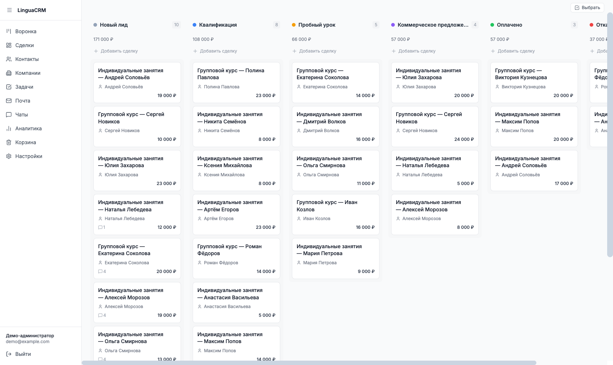
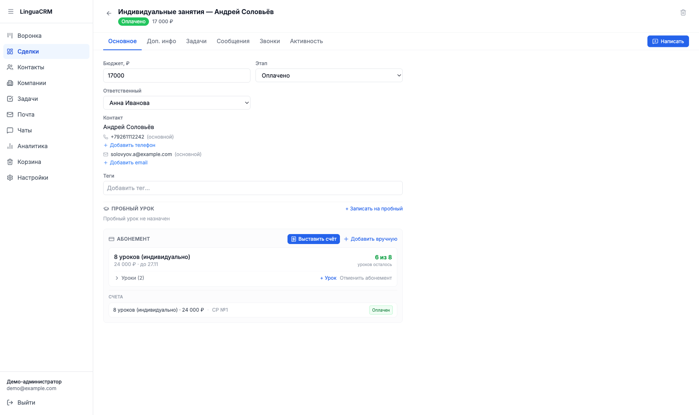
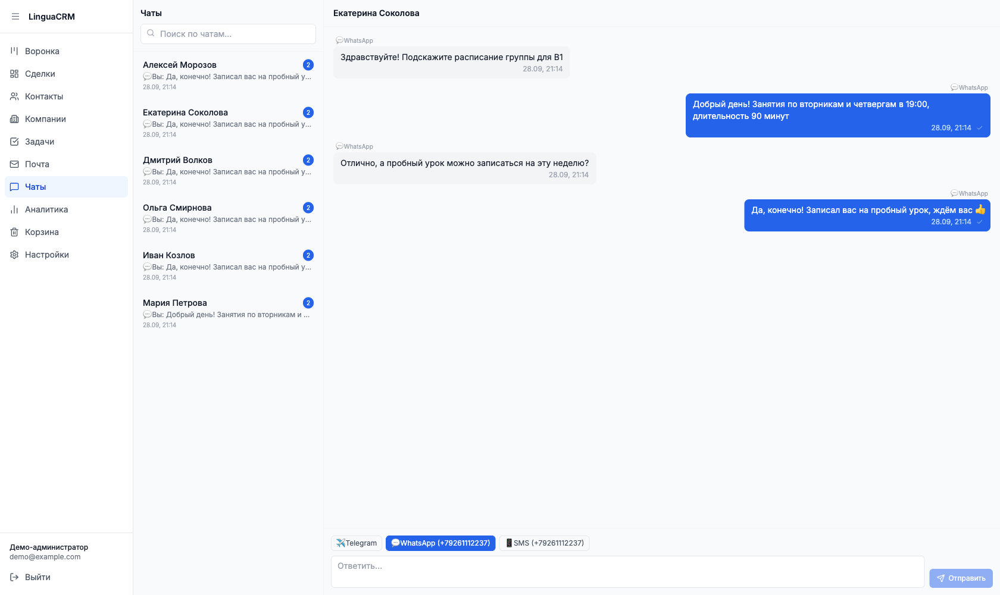
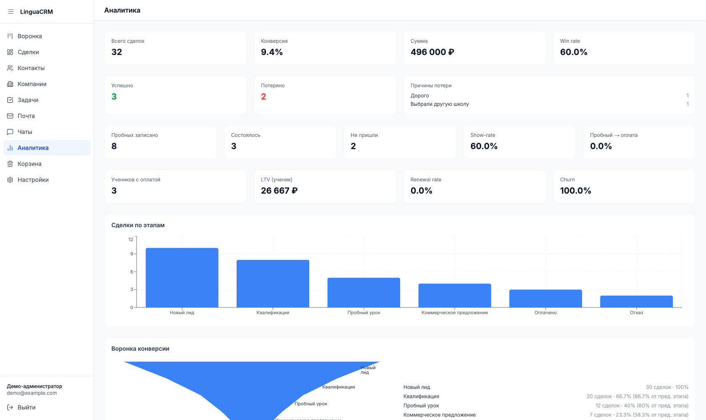
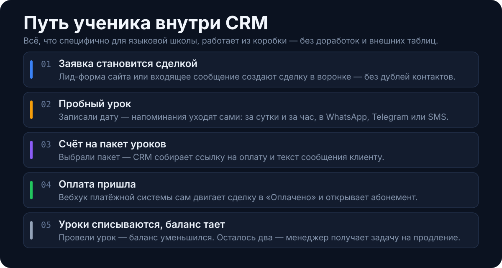
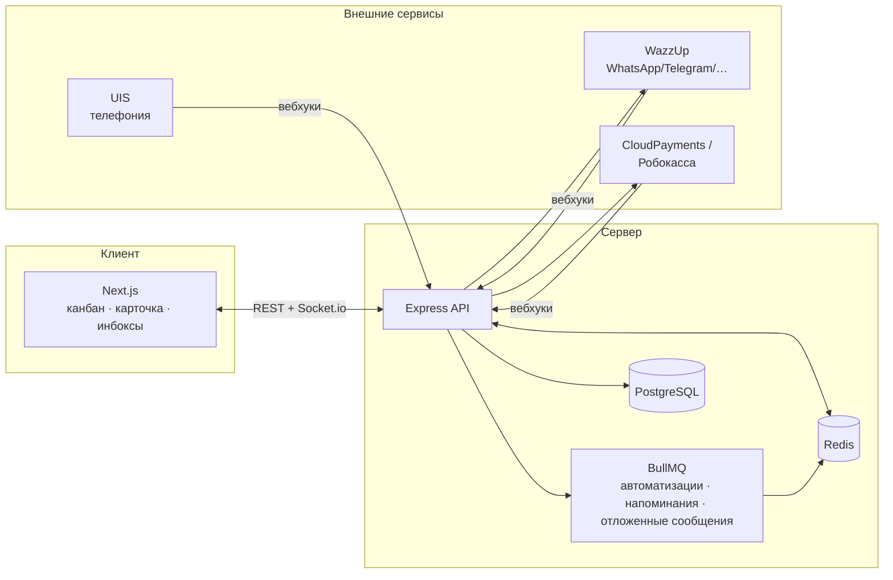

<p align="center">
  
</p>

<p align="center">
  <b>Пет-проект: CRM для онлайн-школы иностранных языков.</b><br>
  Воронка продаж, пробные уроки, абонементы, приём оплат и переписка из мессенджеров в одной карточке ученика.
</p>

<p align="center">
  
  
  
  
  
  
  
  
</p>

<p align="center">
  <a href="#скриншоты">Скриншоты</a> ·
  <a href="#запуск">Запуск</a> ·
  <a href="#возможности">Возможности</a> ·
  <a href="#под-капотом">Под капотом</a> ·
  <a href="#инженерные-решения">Инженерные решения</a>
</p>

---

## О проекте

Универсальная CRM считает, что сделка заканчивается оплатой. У языковой школы после оплаты всё только начинается: ученик приходит на пробный урок, покупает пакет из 8 или 16 занятий, тратит его месяцами и в какой-то момент должен продлить абонемент — иначе он потерян.

LinguaCRM сделана как замена amoCRM под эту модель: пробный урок и абонемент — полноценные сущности, а не строчки в комментарии; напоминания, перенос сделки после оплаты и задача на продление происходят сами. Проект полноценный — монорепо на TypeScript, интеграции с мессенджерами, телефонией и платёжными системами, роли и права, реалтайм, деплой через Docker Compose.

## Скриншоты

Все данные на скриншотах вымышленные — из демо-сида.

**Канбан воронки** — drag-and-drop, суммы по этапам, счётчики сообщений на карточках



<table>
<tr>
<td width="50%" valign="top">

**Карточка ученика** — контакт, пробный урок, абонемент с остатком уроков и счета



</td>
<td width="50%" valign="top">

**Чаты** — единый инбокс WhatsApp / Telegram / SMS с выбором канала для ответа



</td>
</tr>
</table>

**Аналитика** — win rate, причины потери, show-rate пробных, конверсия «пробный → оплата», LTV, продления и отток



## Путь ученика внутри CRM

<p align="center">
  
</p>

## Запуск

Нужны Node.js 20+ и Docker. Демо-режим открывается сразу в канбане без логина: правки живут только в браузере (localStorage), в базу не пишутся, внешние интеграции наружу не ходят.

```bash
npm ci
cp .env.example apps/api/.env
docker compose -f docker-compose.dev.yml up -d     # postgres + redis
npm run db:migrate && npm run db:seed:demo         # схема + вымышленная школа
npm run dev:demo                                   # http://localhost:3000
```

Обычный режим с логином — `npm run dev`. Подробности и разбор частых ошибок — [`docs/demo-stand.md`](docs/demo-stand.md).

## Возможности

<table>
<tr><td width="50%" valign="top">

**Продажи и воронка**
- Канбан с drag-and-drop, свои этапы и цвета
- Типы этапов: в работе / успех / отказ, обязательная причина потери
- Обязательные поля при переходе на этап
- Кастомные поля у сделок, контактов и компаний
- Теги, фильтры, массовые операции, экспорт в CSV/Excel
- Захват заявок с сайта через публичную лид-форму

</td><td width="50%" valign="top">

**Ученики и уроки**
- Пробные уроки: запись, перенос, результат
- Многоканальные напоминания с шаблоном на каждый интервал
- Пакеты уроков и абонементы с балансом и списанием
- Преподаватель у каждого урока
- Поиск и объединение дублей контактов

</td></tr>
<tr><td width="50%" valign="top">

**Деньги**
- Счёт-ссылка: CloudPayments и Робокасса
- Вебхук оплаты сам двигает сделку в «Оплачено» и открывает абонемент
- Ручные оплаты — наличные и переводы
- Аналитика: выручка, LTV, продления, отток, UTM-источники

</td><td width="50%" valign="top">

**Коммуникации**
- WhatsApp, Telegram, VK MAX и др. — через WazzUp
- SMS с шаблонами оператора (TargetSMS)
- Почта: свои SMTP/IMAP-ящики, общие и личные, вложения в S3
- Единые инбоксы чатов и почты, отложенная отправка
- Входящие звонки с записью разговора (UIS)

</td></tr>
<tr><td width="50%" valign="top">

**Автоматизации**
- Триггеры: этап, поле, таймер, пробный урок, оплата, низкий баланс, входящее сообщение
- Действия: задача, сообщение, смена поля, перенос этапа, уведомление, HTTP-запрос
- Визуальный конструктор в настройках

</td><td width="50%" valign="top">

**Доступ и надёжность**
- Роли с матрицей из 12 прав, свои роли
- Корзина: 30 дней на восстановление
- История изменений по каждой сделке
- Обновления у всех сотрудников в реальном времени

</td></tr>
</table>

## Под капотом

| Слой | Технологии |
|---|---|
| Frontend | Next.js 16 (App Router) · React 19 · TypeScript · Tailwind · shadcn/ui · TanStack Query · Zustand · @dnd-kit · Recharts |
| Backend | Node.js + Express · Prisma ORM · PostgreSQL · Redis + BullMQ · Socket.io · Zod |
| Интеграции | WazzUp (мессенджеры) · UIS (телефония) · TargetSMS · CloudPayments / Робокасса · SMTP/IMAP · S3-совместимое хранилище |
| Инфраструктура | Docker Compose · Nginx (TLS + reverse proxy) |



```
apps/
  web/     — Next.js фронтенд (App Router)
  api/     — Express backend: routes / services / prisma
packages/
  shared/  — общие типы и константы для фронта и бэка
```

## Инженерные решения

Несколько вещей, которые было интересно решать:

- **Кастомные поля без миграций.** Значения — в `custom_fields JSONB`, схема полей — в таблице `field_definitions`. Новое поле добавляется из интерфейса, массовая правка — одним SQL-запросом.
- **Источник истины — Postgres, а не Redis.** Напоминания о пробных — delayed-джобы BullMQ с детерминированным `jobId`, но отправленные офсеты хранятся в БД с атомарным клеймом, а reconciliation-sweep догоняет всё, что потерялось при рестарте или потере ключей Redis.
- **Очереди вне критического пути HTTP.** Роут сначала пишет в Postgres и отвечает клиенту, очереди — fire-and-forget: недоступный Redis не подвешивает запросы.
- **Идемпотентные платёжные вебхуки.** Переход статуса через `updateMany where status='pending'` плюс `@unique` на связи платежа и абонемента — повторный вебхук или гонка не создают дубль.
- **Демо-режим без отдельного бэкенда.** Мутации перехватываются на клиенте и накладываются оверлеем поверх реальных GET-ответов, серверный guard блокирует прямые записи.
- **Безопасность.** JWT в httpOnly-cookie с ротацией refresh-токенов и детектом replay, CSRF double-submit, allowlist-схемы Zod на всех PATCH, RBAC с резолвом прав из БД, fail-closed проверка вебхуков, rate limiting в Express и Nginx.
- **Масштаб.** Лимиты на колонки канбана, потоковый экспорт в CSV/XLSX курсорными батчами, кэш аналитики в Redis с таймаутом на случай его недоступности.

Подробный журнал решений и найденных ловушек — в [`CLAUDE.md`](CLAUDE.md), раздел «Важные замечания для разработки».

## Документация

- [`docs/ROADMAP.md`](docs/ROADMAP.md) — описания фич
- [`docs/ROADMAP-full.md`](docs/ROADMAP-full.md) — статус «реализовано / осталось»
- [`docs/demo-stand.md`](docs/demo-stand.md) — как устроен демо-стенд
- [`docs/security-audit.md`](docs/security-audit.md) — security-аудит и его закрытие
- [`docs/vps-migration.md`](docs/vps-migration.md) — ранбук деплоя на VPS
- [`CLAUDE.md`](CLAUDE.md) — полная техническая документация

## Лицензия

[MIT](LICENSE)
